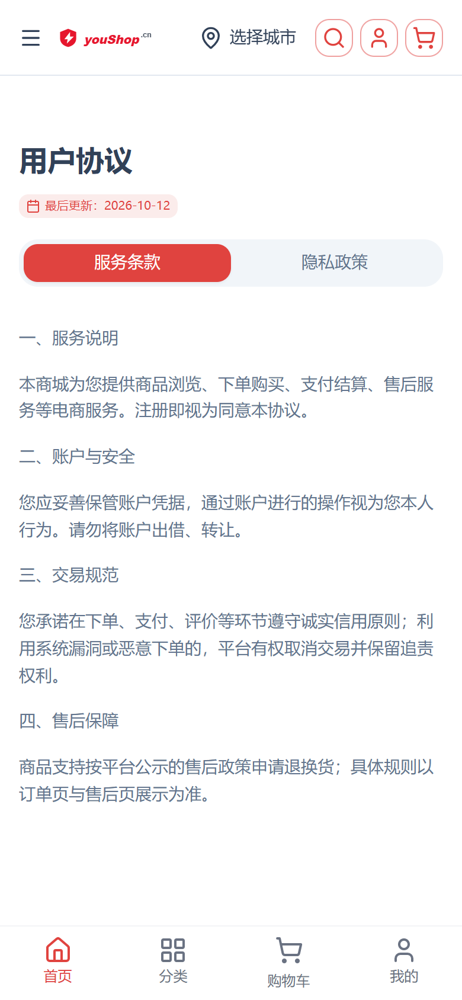
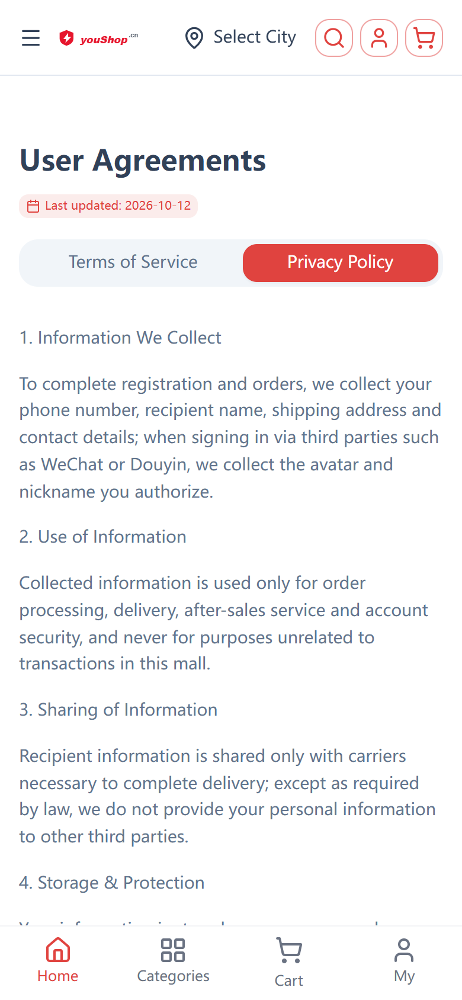
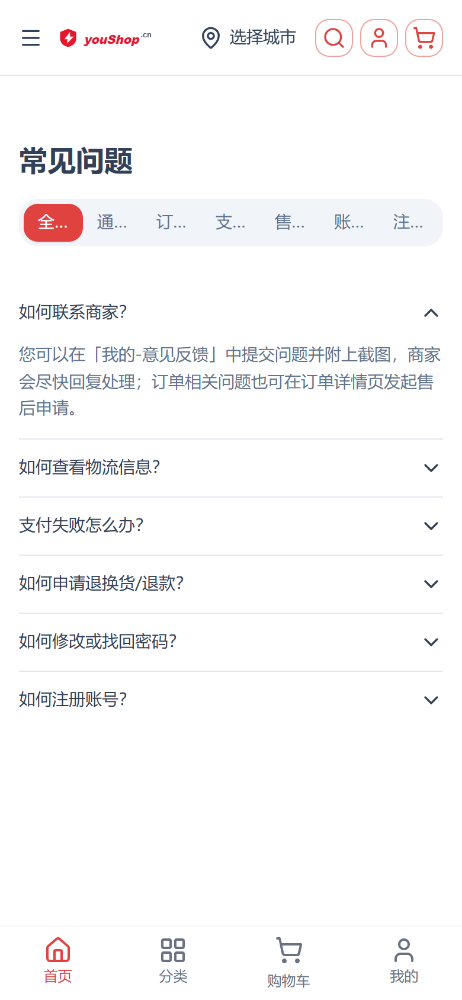
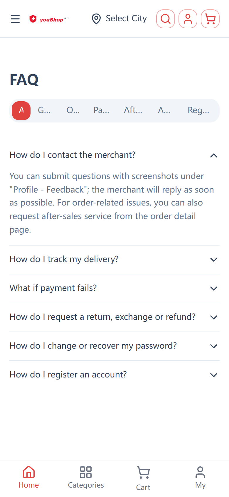
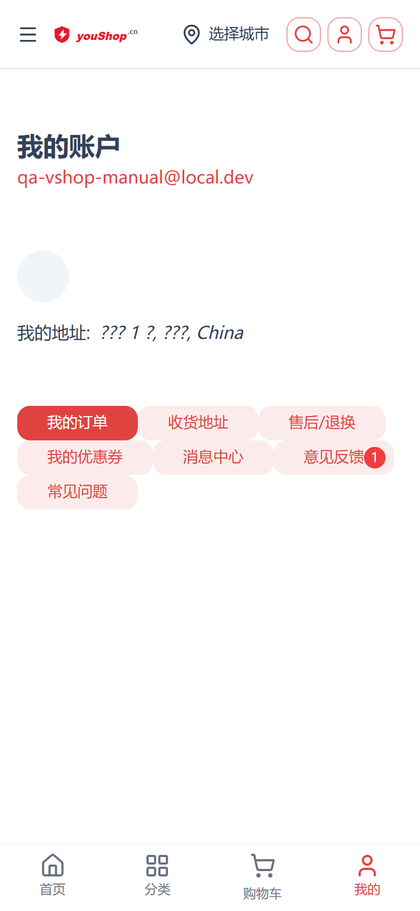
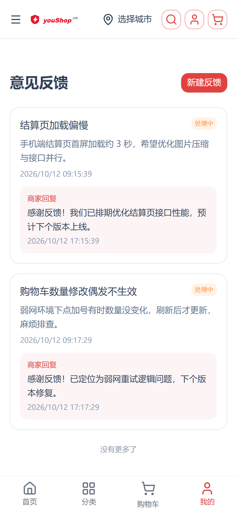
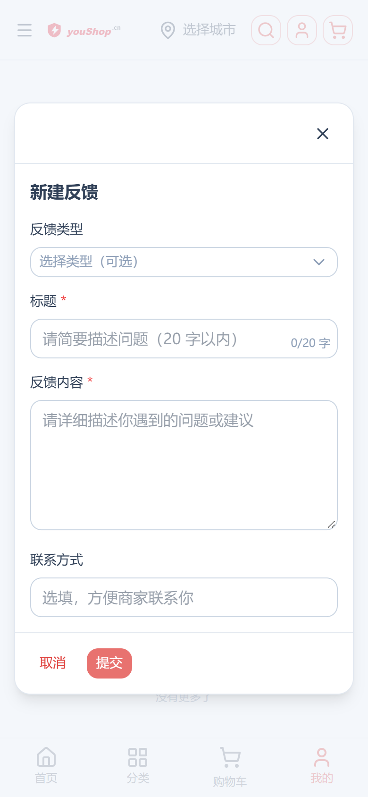

# 内容多语言与反馈闭环：协议页 · 常见问题 · 意见反馈 — 操作手册（nshop 端）

> 日期：2026-10-12
> 代码位置：`d:\zhao\nshop`（C 端三页 + 12 语言包）；后端 `d:\zhao\vendure\packages\feedback-plugin` **零改动**（协议/FAQ/反馈接口均已上线）
> 后端接口：`shopGlobalConfig.defaults.agreement`、`faqs(type, lang)`、`createFeedback / myFeedbacks / markFeedbacksRead / unreadFeedbackCount`
> 方案：A 方案（协议双签 + 更新日期徽章；FAQ 分类 tab + 手风琴；反馈页内 UModal 新建；入口在「我的」兜底菜单，意见反馈带未读角标）
> 截图口径：**手机视口 390×844、dpr=2（780×1688）**、zh-CN 为主 + en 对照
> 截图复现：`python scripts/_shot_content_multilang.py`（QA 客户 `qa-vshop-manual@local.dev` 走真实 UI/API 造数）

---

## 1. 一句话说明

nshop 补齐与 vshop 对齐的三块内容能力：**①协议页**（`/agreement` 服务条款/隐私政策双 tab，SSR 读全局配置五语言文案，checkout 勾选文案变可点链接）、**②常见问题**（`/faq` 七 tab 分类 + UAccordion 手风琴，SSR 一次拉全量客户端过滤）、**③意见反馈**（`/account/feedback` 列表 + 状态徽章 + 商家回复面板 + 页内弹窗新建；「我的」页新增意见反馈（未读角标）与常见问题两个入口；进入反馈页自动全部已读）。

## 2. 功能与截图（C 端 nshop）

| 功能 | 截图 | 说明 |
|---|---|---|
| 协议页·服务条款 |  | `/agreement` 默认服务条款 tab，标题下「最后更新」徽章（updatedAt），正文五语言按 \n 分段 |
| 协议页·en 隐私政策 |  | `/en/agreement?type=privacy`，英文文案 + en 界面语言 |
| FAQ 分类 tab |  | `/faq` 七 tab（全部/通用/订单/支付/售后/账户/注册），手风琴展开显示答案正文 |
| FAQ en |  | `/en/faq`，内容语言随界面 locale 切换 |
| 我的·入口+角标 |  | 兜底菜单新增「意见反馈」（未读数红点，99+ 封顶）与「常见问题」；与站内消息角标并列 |
| 反馈列表+回复面板 |  | `/account/feedback`：状态徽章（待处理/处理中/已解决）、商家回复 soft 卡片、分页「加载更多」；进入页面自动标记全部已读（角标清零） |
| 新建反馈弹窗 |  | 「新建反馈」UModal：类型下拉（bug/体验问题/其他，可空）、标题 ≤20 字计数、内容必填、联系方式 ≤30 字；提交成功 toast + 列表刷新 |

## 3. 接口与数据约定（后端零改动）

| 能力 | 接口 | 关键约定 |
|---|---|---|
| 协议文案 | `shopGlobalConfig(app).defaults.agreement` | `{ service: Record<locale,string>, privacy: {...}, updatedAt }`，内容 locale ∈ zh-CN/zh-TW/en/ja/ko |
| FAQ | `faqs(type, lang)` | type ∈ general/order/pay/afterSale/account/register（不传返回全部）；lang 白名单五内容语言，缺失回退基线 |
| 提交反馈 | `createFeedback(input)` | title ≤20 字、contactWay ≤30 字后端校验；type 可空（缺省 other）；imgs 本期不做 UI |
| 我的反馈 | `myFeedbacks(options)` | status ∈ pending/processing/resolved；含 reply/repliedAt/repliedBy |
| 已读闭环 | `markFeedbacksRead` / `unreadFeedbackCount` | 幂等已读；未读 = readAt 为空且 status≠pending |

- **内容语言映射**（`layers/base/app/utils/content-lang.ts`）：界面 locale → 内容语言键，zh-CN→zh-CN、ja-JP→ja、ko-KR→ko、en-US→en、其余 9 种→en（nshop 无 zh-TW 界面语言）。
- **协议文案回退链**：当前内容语言 → zh-CN → 对象内第一个非空值 → i18n 占位文案；坏数据/缺字段一律 null 兜底，不抛异常不白屏。
- **登录态请求**：反馈四接口走 `useFeedback.ts` 运行时字符串查询（与 useInbox 同款，自动带 `Authorization: Bearer` 会话 token）；FAQ/协议为公开 SSR 查询。

## 4. i18n

- 12 语言包（zh-CN/en-US/ja-JP/ko-KR/fr-FR/de-DE/es-ES/it-IT/pt-BR/ru-RU/bg-BG/fa-IR）同步新增，全部真翻译：
  - `messages.agreement.*`（6 键：pageTitle/serviceTab/privacyTab/updatedAtLabel/fallbackService/fallbackPrivacy）
  - `messages.faq.*`（10 键：pageTitle/tabAll/tabGeneral/tabOrder/tabPay/tabAfterSale/tabAccount/tabRegister/empty/loadFailed）
  - `messages.feedback.*`（26 键：页面/表单/状态/回复/空态/toast 等）+ `messages.account.feedback / faq`（两个入口键）

## 5. 测试用例

| # | 用例 | 步骤 | 预期 |
|---|---|---|---|
| 1 | 协议双签 | `/agreement` 切两个 tab | 服务条款/隐私政策内容正确切换，URL `?type=` 同步，无整页刷新 |
| 2 | 协议 updatedAt 徽章 | 查看 `/agreement` 标题下方 | 显示「最后更新：YYYY-MM-DD」；后台未配 updatedAt 时不渲染徽章 |
| 3 | 协议多语言 | 切 en/ja 等界面语言访问 | 正文与 tab 标题随语言变化；无对应语言时回退 zh-CN |
| 4 | checkout 协议链接 | 结算页查看协议勾选行 | 两段高亮文字为可点链接，分别跳 `/agreement?type=service` / `?type=privacy` |
| 5 | FAQ 分类过滤 | `/faq` 逐个点击七 tab | 列表即时过滤（不发请求）；空分类显示「暂无」占位 |
| 6 | FAQ 手风琴 | 点击任意条目 | 展开显示答案正文（按 \n 分段），再点收起 |
| 7 | FAQ 多语言 | `/en/faq` | 内容为英文；切其他语言内容语言正确映射 |
| 8 | 提交反馈 | 反馈页「新建反馈」填表提交（title 21 字验证截断） | 成功 toast + 弹窗关闭 + 列表刷新出现新条目（待处理徽章） |
| 9 | 反馈必填校验 | 标题/内容留空提交 | 提交按钮禁用 |
| 10 | 商家回复闭环 | admin `replyFeedback` 回复后顾客进入反馈页 | 列表出现「商家回复」面板 + 处理中徽章；进入页面后角标清零（markFeedbacksRead 幂等） |
| 11 | 未读角标 | 有未读回复时看「我的」页 | 「意见反馈」入口显示未读数（99+ 封顶），与站内消息角标样式一致 |
| 12 | 未登录拦截 | 未登录直接访问 `/account/feedback` | account middleware 跳登录页 |
| 13 | 加载更多 | 反馈 >20 条时点「加载更多」 | 按 id 去重追加；全部加载后显示「没有更多了」 |

## 6. 回归核对（2026-10-12 实测）

| 验收项 | 执行处 | 结果 |
|---|---|---|
| nshop 生产构建 | `pnpm build`（本地；Start-Process 重定向日志绕开 PowerShell stderr 误杀） | 绿（`✨ Build complete!`） |
| 部署 | 手动受控 scp → 远端 cp + chown + `pm2 restart nshop`（deploy.mjs 在 Windows 有 scp 竞态，见 §7） | 绿（pm2 nshop online，localhost:3000 = 200） |
| 线上 SSR 冒烟 | curl 线上 SSR HTML 关键词 | 绿（agreement 5 处 / faq 中文 13 处 / 英文 12 处关键词命中） |
| 手机截图 7 张 | `python scripts/_shot_content_multilang.py`（390×844、dpr=2） | 绿（c1–c7 URL 全部正确；c5 角标=1、c1 更新徽章 2026-10-12、c6 商家回复面板目检通过） |
| 12 语言包键一致 | grep 计数校验 | 绿（agreement/faq/feedback/account 四组键名 12 包全一致） |

## 7. 已知边界

- nshop 无 zh-TW 界面语言，zh-TW 内容仅在后端存在（其他端可用）；en 作为第 4 内容语言兜底。
- 反馈图片附件（imgs）后端已支持，nshop 本期不做上传 UI，与 vshop 对齐后续再补。
- 本地 `graphql.schema.json` 快照由线上内省刷新（`node %TEMP%\nshop-introspect.mjs` 流程），已剥除新规范 `DIRECTIVE_DEFINITION` location 以兼容本地 graphql 16 解析器；后续如再报同错按此刷新。
