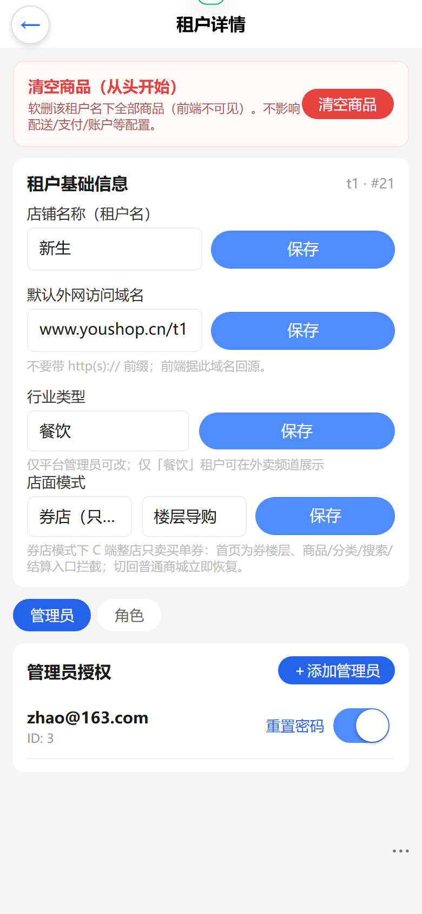
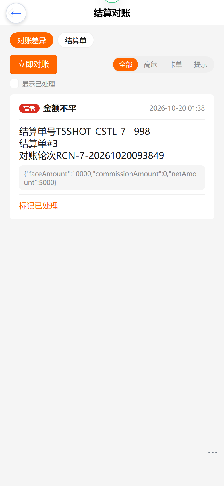
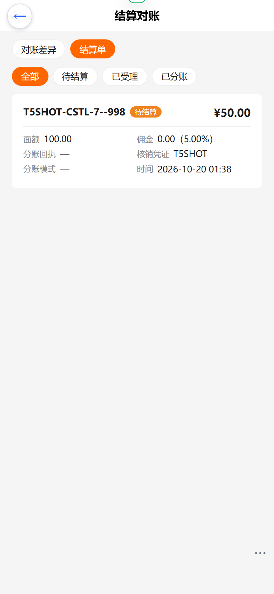

# 券店模式（Coupon Storefront）操作手册

> 功能迭代：2026-10-18 · 计划 [2026-10-18-coupon-storefront-mode.md](../../../plans/2026-10-18-coupon-storefront-mode.md) · 设计 [2026-10-18-coupon-storefront-mode-design.md](../../../plans/../../docs/superpowers/specs/2026-10-18-coupon-storefront-mode-design.md)

## 1. 功能说明

**租户券店模式**：平台可把某个租户（渠道）整店切换为「券店」——C 端（nshop）该租户只卖买单券：

| 配置项 | 取值 | 说明 |
| --- | --- | --- |
| 店面模式 `storefrontMode` | `normal`（默认） / `coupon` | coupon = 券店：首页渲染券店版式、商品/分类/搜索/结算路由拦截、TabBar/Header 券店化 |
| 券店首页版式 `storefrontHomeLayout` | `floors`（默认） / `grid` | 仅 coupon 模式生效：floors = 楼层导购（吸顶锚点 + 单券/券包/积分楼层）；grid = 券卡宫格（2 列面额大字卡 + 券包 + 积分行） |

- 目录匿名可浏览（新客未登录可看券楼层，点抢购引导登录）；购买/支付仍需登录。
- 只售 `usageScene=IN_STORE`（到店）买单券；到店出示券码、商户核销，链路复用既有优惠券体系。
- 值存于 `Channel.customFields`（vendure cjk-plugin），仅平台管理员可改（租户自助更新白名单不含这两个字段）。
- 坏值兜底：`storefrontMode` 非 `coupon` 一律按 `normal`；`storefrontHomeLayout` 非 `grid` 一律按 `floors`。
- 切回 `normal` 立即恢复普通商城（nshop 每次请求 SSR 读渠道主题，无需重建）。

## 2. 平台侧配置路径（web-admin）

1. 登录 web-admin → **平台管理 → 租户管理** → 选择目标租户（如「新生 t1」）。
2. 详情页「行业类型」下方新增**店面模式**表单块：
   - 「店面模式」picker：普通商城 / 券店（只卖买单券）；
   - 选「券店」后出现「券店首页版式」picker：楼层导购 / 券卡宫格；
   - 点「保存」即时生效（写 `Channel.customFields.storefrontMode/storefrontHomeLayout`）。



> 表单已于 2026-10-18 在生产环境浏览器实测通过：superadmin 登录可见平台侧租户管理入口，表单渲染正常（截图）；保存链路经表单同一 `updateTenant` API 实测（t1 版式 grid→floors 回退写入 customFields，C 端即时生效）。双 picker 行在窄屏下的文字重叠已同步修复（picker-val 改弹性省略）。

## 3. 运营侧：券上架（t1）

券店首页数据源 = 券商城可售目录（`couponSaleCatalogue(scene: "IN_STORE")`，渠道过滤自动隔离）：

1. web-admin / 运营后台 → **优惠券模块** → 创建券模板：`usageScene=IN_STORE`、设定 `salePrice`（售价，分）、分发渠道含 **SALE**（可售）。
2. 券包（Bundle）同理：打包多张券 + 包价。
3. 积分兑换楼层（仅 floors 版式展示）：积分商城券模板自动进入「积分兑换」楼层。
4. 售罄判定（2026-10-18 修正）：售卖场景口径 = `totalCount>0 && claimedCount>=totalCount`（前端 `saleCardProgress`）；`claimable=false` 仅表示「不开放免费领取」，**不再误判为售罄**（免费领券场景仍用 `saleProgress` 原口径）。全部售罄/空目录显示空态文案「买单券即将上架，敬请期待」。

## 4. C 端动线（nshop）

```
首页（券店版式：店招 + 楼层/宫格）
  → 点券卡 → 详情弹层（图文介绍/范围/须知）
  → 抢购 → 未登录 → 跳登录 → 回来再买
  → 已登录 → 下单（出售单）→ PaySheet（微信 JSAPI / 余额）→ 支付成功
  → 我的券包（/coupon）→ 到店出示券码 → 商户核销
```

- 券店 TabBar 四 tab：**首页 / 券包 / 券单 / 我的**（`/coupon/orders` 券单页可看历史出售单，PENDING 单可继续支付）。
- Header 精简：无分类导航/搜索/购物车，保留 Logo、城市/租户选择器、账号菜单。
- 直连商品 URL（`/t1/product/x`、`/t1/search`、`/t1/checkout`、`/t1/category/...`）被全局中间件拦截到 `/t1/coupon-only` 提示页「本店仅售买单券」。

## 6. 售卖页转化升级（2026-10-18 · 版式 A 大图沉浸卡）

针对「券内容单调、无购买欲」的改造（调研对标美团团购详情七要素 / 抖音信任标签）：

| 升级点 | 说明 | 位置 |
| --- | --- | --- |
| 大图沉浸券卡 | 券名关键词自动映射场景插画（台球/餐饮/饮品/通用四类内联 SVG），头图 +「到店可用」角标 + 折扣大字（「0.80」→「8折」，en 为 Save 20%）+ 算账 caption（消费¥100 立省¥20） | `CouponStoreCouponCard.vue`（新） |
| 折扣语义化 | 纯函数 `formatCouponDiscount`（PERCENT 80→8折/85→8.5折），券店卡与详情弹层统一 | `utils/coupon-mall.ts` |
| 详情弹层算账条 | PERCENT 付费券显示「例：到店消费¥100，按8折立省¥20」 | `DetailSheet.vue`（条件渲染） |
| 详情弹层三步流程 | IN_STORE 券显示「在线购券 → 到店消费 → 出示券码结算」 | 同上 |
| 信任行 | 「到店出示券码 · 全场通用」（券卡+店招，诚实文案：无虚构销量/退款承诺） | 券卡/店招 |
| 店招 hero 升级 | 新增信任小字 +「低至¥X」（取可售券最低价，动态计算非写死） | `CouponStoreHome.vue` |
| 购买须知改写 | 「售出后不支持退款」→「请在有效期内到店核销，未使用可联系客服处理」（双语） | i18n `couponMall.noticeText` |
| P0 修复 | `saleCardProgress`：售卖场景忽略 claimable，付费券不再误显示「已抢罄」 | `utils/coupon-mall.ts` |

> 文案红线（对齐抖音营销噱头规范）：「已售N份」「随时退」等标签在真实销量/退款政策落地前**禁止展示**；销量数据接入见后端 P2（`coupon_sale_order` 支付单聚合），退款政策落地后再补「随时退/过期自动退」标签。

新增 i18n 词条（zh-CN/en-US 同步）：`couponStore.savingsLine / validAfterDays / remaining / trustLine / asLowAs / calcExample / flowStep1-3`。

> 2026-10-18 生产验收：手机视口（390×844 dpr=2）截图确认 C10/C11 全部通过（两张券卡「8折」可抢购、弹层算账条/三步流程/正向须知齐备）；SSR 探针 `hero-trust` 确认新版上线。注意：浏览器端验证若遇旧页，先清 Service Worker/Cache Storage 再硬刷新（部署切换窗口的残留缓存会导致误判）。

## 6.1 营销数据升级（2026-10-18 · P2：真实已售数 + 划线价 + 营销标签 + 券包）

| 升级点 | 说明 | 位置 |
| --- | --- | --- |
| 真实已售数 | `couponSaleCatalogue` 按渠道聚合**已支付（PAID）出售单**计数，单券/券包均下发 `soldCount`；退款（REFUNDED）/取消单不计入。**C 端仅 soldCount>0 才展示「已售N」**——无真实成交不显示（营销噱头红线） | coupon-plugin `coupon-sale.service.ts` |
| 划线锚定价 `anchorPrice` | coupon_template 新列（分）。web-admin 券表单「划线原价」可选填；C 端**仅当 anchorPrice > salePrice 才展示划线价**（`couponAnchorYuan` 防误导），划线价禁写死 | 实体/迁移 `add-coupon-marketing-fields` |
| 营销标签 `label` | coupon_template 新列（≤30 字）。web-admin「营销标签」可选填（建议 6 字内如「热卖TOP」）；C 端券卡头图左上红色角标 + 详情弹层头部标签，空不展示 | 同上 |
| 券包真实已售数 | CouponBundle 下发 `soldCount`，券包卡名称旁展示（同样 >0 才显示） | coupon-plugin |
| t1 首批配置 | 券 83 anchorPrice=990/label=热卖TOP；券 84 anchorPrice=990/label=人气爆款；券包 id=2「超值2张券包」（餐饮1张+台球1张，包价 ¥9，挂渠道 7） | admin-api |
| 券包条目折扣语义 | BundleCard 条目 PERCENT 券显示「8折 ×1」而非「¥0.80 ×1」（discountValue 是折扣值不是面额） | `BundleCard.vue` |

**运营配置路径**：web-admin → 优惠券模块 → 编辑券模板 → 「券商城」渠道下填**出售价 + 划线原价（可选）+ 营销标签（可选）**；券包在券包管理创建（选券 + 数量 + 包价）。

验收截图（手机视口 390×844 dpr=2）：[2026-10-18-t1-marketing-upgrade/](../../../manual/shots/2026-10-18-t1-marketing-upgrade/)（01 首页营销标签/划线价/8折；02 详情弹层标签+划线价+算账条+三步流程；03 券包楼层）。DOM 断言见 `verify-log.json`（soldCount=0 时「已售」正确隐藏）。验证脚本 `scripts/_shot_coupon_marketing.mjs`。

> 倒计时活动位：**挂起**，待运营定活动政策（门槛/力度/时段）后再实施。首购立减 / 学生价已于同日实施（见 6.2）。

## 6.2 首购立减 + 学生价（2026-10-18 · P3）

**政策规则**（方案：[2026-10-18-coupon-firstbuy-student-price.md](../../../plans/2026-10-18-coupon-firstbuy-student-price.md)）：

- **首购立减**：渠道级配置（Channel customFields `firstBuyDiscount`，分）。资格 = 本店**无 PAID 券单**（每用户 1 次；退款/取消不占资格）。匿名按新客展示首购价引导转化。
- **学生价**：券模板级配置（coupon_template `studentPrice`，分）。仅**学生认证通过**（Customer customFields `studentStatus=approved`）后展示并按学生价结算；未认证只在详情弹层显示「认证学生享学生价，去认证」引导。
- **计算口径**：两路径**各自从券原价独立计算、取低不叠加**；同价优先记学生价；到手价最低 ¥0.01。后端 `resolvePromoPrice` 下单重算，不信任前端价格；让利记入出售单 `discountType/discountAmount`。

| 实现点 | 说明 | 位置 |
| --- | --- | --- |
| 后端迁移 | 7 个新列幂等迁移；**列名须与 TypeORM metadata 一致**（customFields 嵌入列带 `customFields` 前缀，如 `customFieldsFirstbuydiscount`），裸名列会被 synchronize 每次启动 DROP 且读值恒空（本次踩坑） | coupon-plugin `migrations/add-coupon-promo-fields` |
| 目录下发 | `couponSaleCatalogue` 增 `firstBuyDiscount / firstBuyEligible / studentApproved`（按登录态计算） | coupon-plugin `coupon-sale.service.ts` |
| 下单重算 | `createSaleOrder` 调 `resolvePromoPrice`（纯函数，21 单测覆盖：取低不叠加/同价优先学生/最低 1 分/资格边界） | 同上 |
| 学生认证流 | shop：`myStudentVerification` / `applyStudentVerification`（学校+学号+学生证照片，approved 不可重提，驳回可改重提）；admin：`studentVerifications(status)` / `reviewStudentVerification`（@Allow UpdateCustomer） | coupon-plugin `student.service.ts` / `student.resolvers.ts` |
| C 端展示 | 券卡/详情弹层 promo 标签（首购红/学生青）+ 划线原价 + 到手价 + 价格明细三行（券售价→优惠→到手） | `CouponStoreCouponCard/CouponGridCard/BundleCard/DetailSheet` + `couponPromoPrice` |
| C 端认证页 | `/coupon/student-verify`：状态卡（审核中/通过/驳回重提）+ 表单（照片上传复用 AfterSalesEvidenceUploader）；匿名访问跳登录 | `pages/coupon/student-verify.vue` |
| web-admin | 券编辑「学生价（元）」字段；租户详情「首购立减（元）」；营销菜单「学生认证审核」页（pending/approved/rejected 三 tab + 照片预览 + 通过/驳回） | vshop web-admin |

**t1 上线配置**（SQL 直配）：Channel 7 `customFieldsFirstbuydiscount=200`（首购立减 ¥2）；券 84（台球买单券 ¥5）`studentPrice=300`（学生 ¥3，与首购价同价 → 验证「同价优先学生价」）。券 83 未配学生价。

验收截图（手机视口 390×844 dpr=2）：[2026-10-18-coupon-firstbuy-student/](../../../manual/shots/2026-10-18-coupon-firstbuy-student/)（01 首页首购红标+¥5 划线+¥3 到手；02 详情明细三行；02b 台球券学生认证引导；03 认证页登录门）。DOM 断言见 `verify-log.json`。验证脚本 `scripts/_shot_coupon_firstbuy.mjs`。

## 6.3 倒计时活动位（2026-10-18 · P4）

券店首页店招下的限时活动大卡（版式 B）：活动标题/副标题 + `hh:mm:ss` 数字块走秒（超 100 小时直接累计小时位）+ 关联券 mini 卡直达详情弹层 + 规则文案行；走秒到点自动摘除。**不改券价格**——mini 卡现价沿用首购/学生价既有展示逻辑，活动只做高亮引流。

**政策规则**（方案：[2026-10-18-coupon-countdown.md](../../../plans/2026-10-18-coupon-countdown.md)）：

- **单场承载**：Channel customFields `couponCampaign`（JSON 字符串，**列宽 varchar(4096)**——customFields string 默认 255 装不下活动 JSON，本次踩坑）。到点自动上/下线：后端按**服务端时钟**判时间窗（不信任前端），窗口外/未配置/禁用/坏 JSON/关联券全不命中 → 下发 `campaign=null` 前端不渲染。
- **关联券**：配置 `templateIds` 有序列表（web-admin 按勾选顺序展示），命中本店**可售**券（他店/下架自动过滤）；文案 `name/subtitle/rules` 为 LocalizedText（中/英，兜底链：当前 lang → 去地区码 → 首个非空）。
- **前端走秒**：SSR 首渲染 `--:--:--` 占位（避免 hydration mismatch），挂载后秒级刷新，到 0 emit `expired` 由页面移除。

| 实现点 | 说明 | 位置 |
| --- | --- | --- |
| 配置解析/下发 | `parseCouponCampaignConfig`（坏 JSON 返 null）/ `localizeCampaignText` / `resolveActiveCampaign`（纯函数，单测覆盖）；`saleCatalogue` 返回 `campaign` | coupon-plugin `coupon-sale.ts` / `coupon-sale.service.ts` |
| 迁移 | `channel.customFieldsCouponcampaign` varchar(4096)，已建窄列幂等 ALTER 放宽 | coupon-plugin `migrations/add-coupon-promo-fields` |
| 后台入口 | `updateTenant` input 增 `couponCampaign`（并补上此前 `firstBuyDiscount` 未声明的缺口）；租户详情「倒计时活动位」配置卡：开关/中英文案/日期+时间 picker 时间窗/关联券多选弹层 | cjk-plugin `tenant-member.service.ts` + vshop web-admin 租户详情 |
| C 端活动卡 | 标题+副标题+数字块+mini 卡（现价/划线价/抢购→`openDetail` 详情弹层）+规则行；floors/grid 两版式通用 | `CouponStoreCampaignCard` + `CouponStoreHome` |

**t1 上线配置**（SQL 直配，运营后续在 web-admin 自改）：Channel 7 `customFieldsCouponcampaign` = 周末限时特惠（窗口 2026-10-18 00:00 → 10-25 22:00，关联券 83/84）。

验收截图（手机视口 390×844 dpr=2）：[2026-10-18-coupon-countdown/](../../../manual/shots/2026-10-18-coupon-countdown/)（01 活动大卡：标题+165:57:30 走秒数字块+餐饮/台球 mini 卡+规则行；02 mini 卡点击直达详情弹层，首购明细联动）。DOM 断言见 `verify-log.json`（含走秒前后对比）。验证脚本 `scripts/_shot_coupon_countdown.mjs`。

## 6.4 独立券详情页（2026-10-19）

券详情从「仅弹层」升级为**独立可分享 URL 页面** `/t1/coupon/[id]`（数字 id = 单券，`b` 前缀如 `b2` = 券包），用于微信分享卡 / 到店物料二维码直达。版式 A 大图沉浸式（美团团购详情风，A/B mockup 用户定稿）：高构图场景插画头图（`CouponStoreSceneArt tall` 变体）+ 营销标签/到店可用角标 + 「8折」折扣大字 + 算账条 + 价格明细三行 + 图文介绍 + 适用范围 + 使用信息/三步流程 + 购买须知 + 限量进度 + 吸底 CTA（避让券店 TabBar）。

| 实现点 | 说明 | 位置 |
| --- | --- | --- |
| 详情页 | 数据与弹层 DetailSheet 完全同源（同 util 纯函数）；目录用 **ONLINE+IN_STORE 双场景查询合并**——后端 scene 是过滤语义（券 usageScene 需命中查询场景，无「不过滤」选项），传 ALL 会导致单券全空（本次踩坑） | `pages/coupon/[id].vue` |
| 场景插画组件抽取 | 券卡内联 SVG 抽为 `CouponStoreSceneArt`（strip 320×72 券卡 / tall 360×180 详情页两变体），券卡改引用组件，几何不变 | `components/coupon-store/SceneArt.vue` |
| 路由放行 | `/coupon/` 前缀不在 tenant.global 拦截名单，直连天然可达；guard 拦截仅针对商品/分类/搜索/结算 | `middleware/tenant.global.ts` |
| 状态兜底 | 匿名+加载失败 → 登录引导卡；其余失败 → 重试；目录成功但无此券 → 「此券已下架或不存在」+ 回首页 | 同上 |
| 购买链路 | 复用 `useCouponSaleFlow`（与券店/券商城同款 PaySheet），匿名抢购跳登录 | 同上 |
| SEO/分享 | og:title/og:description/og:image（渠道分享图 → 域名 logo 兜底）+ `share:image` meta（WechatShare JS-SDK 读）SSR 烘焙 | 同上 |
| preview 调试基建 | `useGqlHostUrl` SSR 分支优先读运行时 `NUXT_PUBLIC_GQL_HOST`（生产烧录同源值等价，preview 免重建直连真实 API）——此前 SSR 固定用请求 origin + /shop-api，本地 preview 无 nginx 代理必然 404 | `composables/useGqlHostUrl.ts` |
| i18n | `couponDetail.title/notFound/bundlePrice` zh-CN/en-US 同步（本模块词条口径与既有券店模块一致） | `i18n/locales/*.ts` |

验收截图（手机视口 390×844 dpr=2）：[2026-10-19-coupon-detail-page/](../../../manual/shots/2026-10-19-coupon-detail-page/)。验证脚本 `scripts/_shot_coupon_detail_page.mjs`。

## 6.5 分类楼层（2026-10-19 · 自适应阈值分组）

券多起来后（>20 张）单券楼层一拉到底，升级为**自适应分类楼层**（A 版式配置化方案 mockup 定稿）：

- **阈值策略（前端纯函数，后端零逻辑）**：`templates.length ≤ 20` 或券模板全未配 `category` → 按**券类型**自动分组（代金→折扣→满减→免邮，零配置，空组剔除，复用既有 `messages.coupon.type*` 词条）；`> 20` 且存在已配 `category` → 按**业态**分组。
- **业态配置**：渠道 customFields `couponFloorGroups`（JSON 数组，web-admin 平台侧可配）形如 `[{"key":"food","title":{"zh-CN":"美食","en":"Food"}}]`；楼层顺序=配置顺序，未命中配置/未配 category 的券归「更多」兜底楼层（末尾）。
- **数据链**：`coupon_template.category` 新列（varchar 可空，AddCouponCategoryFieldMigration 幂等补列）；admin create/updateCouponTemplate 输入透出（trim/30 字上限/空归 null），SDL 共享 couponTemplateType → shop-api `couponSaleCatalogue` 自动带出；nshop 目录 GQL 字段清单 + GetChannelTheme 同步补字段（graphql.schema.json 经 `scripts/update-schema.cjs` 从生产刷新）。
- **交互**：吸顶分类 chips 与锚点条融合（多组才渲染，横向滚动隐藏滚动条）；点 chip `scrollIntoView` 平滑滚动 + 高亮；scroll spy（passive scroll 监听）滚动自动高亮；加载完成 `nextTick(onScroll)` 初始高亮首楼层；券包/积分楼层保持末尾不受影响。

| 实现点 | 说明 | 位置 |
| --- | --- | --- |
| 分组纯函数 | `groupSaleTemplates`（阈值判定/类型序/业态配置序/「更多」兜底/多语言标题 localizeText 回退）+ `parseFloorGroups`（坏 JSON/非数组→null 回退类型分组），SSR 友好 | `utils/coupon-mall.ts` |
| 楼层渲染 | 单券楼层改为 `v-for saleGroups`（key=`sale-${g.key}`），chips=type 组+业态组+券包/积分；删旧固定 sale 楼层 | `components/coupon-store/CouponStoreHome.vue` |
| 后端字段 | `category` 列 + 迁移 + admin 输入/SDL + cjk 渠道 customFields `couponFloorGroups`（public，仅 coupon 模式生效）+ updateTenant 输入链 | vendure coupon-plugin / cjk-plugin |
| admin 表单 | 券模板编辑（SALE 渠道）新增「业态分类」输入 + 提示文案；平台租户详情可配 couponFloorGroups（coupon 模式才显示的 JSON 文本域：校验数组/唯一 key，空=回退类型分组；生产实测回显/渲染正常，截图 docs/screenshots/2026-10-19-floor-groups-admin/） | vshop web-admin |
| i18n | `couponStore.floorMore`（更多/More）zh-CN/en-US 同步（其余语言走 zhFallbackLocale 兜底，与本模块既有词条口径一致） | `i18n/locales/*.ts` |

验收截图（手机视口 390×844 dpr=2）：[2026-10-19-coupon-floor-groups/](../../../manual/shots/2026-10-19-coupon-floor-groups/)（type-mode-home / category-mode-home / category-mode-chip-click）。验证脚本 `%TEMP%\_shot_coupon_floor_groups.mjs`（Playwright mock couponSaleCatalogue 21 张带 category 券 + route.fulfill 中转生产 API）。

## 6.8 P1 营销玩法（2026-10-19 · FR-C 分享裂变 / FR-D 新客 1 元购 / FR-E 召回与等级券）

### FR-C 分享裂变领券

- **配置**（web-admin「优惠券 → 营销活动」弹窗 · 分享裂变 Tab）：启用 + 活动名称 + 副标题/规则 + 起止日期 + 被分享者奖励券（必选）+ 分享者奖励券（可选）+ 分享者获奖上限（0=不限）+ 仅新客可参与。落 `Channel.customFields.couponFission`（JSON，多语言文案可后台二次编辑保留 zh_Hans 键）。
- **C 端动线**：券店首页店招下渲染紫色渐变裂变条（活动名 + 双方奖励摘要 + 规则 +「分享得券」按钮）。微信内点分享 → 引导右上角「···」转发（分享卡由 WechatShare 自动带 `?invite=我的邀请码`）；非微信 → 复制带 invite 的链接。
- **个人邀请码 = 可逆码 `F<base36(customerId)>`**（2026-10-20 定稿）：每人固定一人一码，后端 `parseReversibleInviteCode` 解码直定位分享者（校验本租户渠道归属）。⚠️ `Customer.customFields.inviteCode` 是「被谁邀请」的首次快照（bind 不覆盖、存量全空），**不是**个人码——仅作非 F 码（SSO 旧链路）的回退反查，勿再往分享链上接。前后端编解码同构：nshop `fissionInviteCodeOf` ↔ vendure `buildReversibleInviteCode`。
- **领奖闭环**：好友经分享链接进店 → 未登录底部弹微信一键登录（WechatInviteLoginBar，returnUrl 保留 invite 穿透登录）→ 登录后裂变条自动领奖 → 双方各得 1 张（issuedBy=**FISSION** 渠道留痕）→ 结果状态行内展示（成功/已领过/自分享/仅新客/已领完）。
- **后端规则**：`coupon_fission_record` 实体（渠道+被分享者唯一索引=同人同活动仅 1 次=幂等原子保障）；发奖事务化（withTransaction：扣量→建券→落记录，任一步失败整体回滚）；计入模板限量（R2）；四例外齐备（未登录/下线仅展示/自分享不发奖/限新客）；管理端 `couponFissionRecords` 查询可核对留痕（R1）。

### FR-D 新客 1 元购

- **配置**：同一「营销活动」弹窗 · 新客 1 元购 Tab：启用 + 名称 + 结束日期 + 关联券（SALE 在售候选）+「仅新客可见」开关。落 `couponCampaign`（复用倒计时活动位，`newCustomerOnly: true`）。
- **可见性**（服务端下发侧过滤）：非新客（本租户有历史有效订单 **或** 已持新客券）登录后不下发该活动位；关联券全售罄整位摘除；券卡标题加「新人专享」徽标。
- **硬拦**：`createCouponSaleOrder` / 加价购对新客券双重校验——综合新客判定 + 每人限购 1 张（含 PENDING 单占位，防重复下单绕过）；不达标抛「new customers only / limit reached」。1 元为运营定价（改券模板出售价即可），机制不依赖具体价格。

### FR-E 沉睡召回与会员等级券

- **E1 批量召回**：web-admin「优惠券 → 召回发放」弹窗：选召回券（GRANT 渠道候选）+ N 天未消费（默认 90）+ 站内信通知开关 → 「预览圈中人数」（只数不发）→「批量发放」。逐人走 RECALL 渠道留痕 + R4 防骚扰（同渠道同模板 RECALL 券 7 天内不重发）+ 会员门槛单人不达标跳过（MEMBER_LEVEL_BLOCKED）；`coupon_grant_batch` 批次留痕（圈中/成功/拦截数 + 逐人明细 JSON），弹窗内批次列表点开看摘要（前 10 行），管理端 `couponGrantBatches` 可查。
- **E2 等级券**：券模板 `memberLevel` 字段激活（编辑页已有输入：数字 1-5 或 银/金/白金/钻石 别名）。三路拦截：券店目录/中心券列表/积分商城按登录人等级过滤（匿名按 1 档非会员）；领取（claimCoupon）与兑换（points exchange）、购买三处硬拦。全部无门槛时零额外等级查询（fail-open：会员插件未注册不阻塞）。

## 6.9 FR-F 营销玩法（2026-10-20 · FR-F1 每日领券 / FR-F2 神券日限量抢 / FR-F3 支付有礼）

> PRD：[docs/coupon-frf-prd.md](../../../coupon-frf-prd.md)（v1.2，验收判据 A1-A6/B1-B5/C1-C6 + 共享规则 R1-R7 + 生产审计记录）。版式决策：方案 A（券店首页内嵌楼层，mockup 评审定稿）。

**配置**（web-admin「优惠券 → 营销活动」弹窗新增三个 Tab，落 `Channel.customFields`，坏 JSON/缺字段整体不启用不炸页面 R6）：

| Tab | 字段 | 落点 |
| --- | --- | --- |
| 每日领券 | 启用 + 名称/副标题/规则（中英双语）+ 起止日期 + 券模板组（1~5 张） | `couponDailyClaim` |
| 神券日 | 启用 + 名称/副标题/规则 + 时间窗（精确到分钟）+ 关联券（**为每场单独建限量券模板**，限量靠 totalCount）+ 每人限抢（默认 1） | `couponFlashSale` |
| 支付有礼 | 启用 + 奖励券（单张）+ 门槛实付金额（元，0=不限）+ 冷却天数（强制 ≥1） | `couponPayGift` |

**C 端动线**（nshop 券店首页内嵌 + 订单完成页）：

- **每日领券卡**：店招下橙色卡，每张券「可领 / 今日已领」两态一键逐张领取；**每人每券每天限领 1 张**（UTC+8 日界，跨天可再领）；未登录点领取引导登录；模板 totalCount/perUserLimit/会员等级门槛（E2）照常生效。新实体 `coupon_daily_claim_record`（渠道+用户+模板+日期唯一索引 = 幂等原子保障，发券与落记录同事务），`issuedBy='DAILY'`。
- **神券日楼层**：倒计时走秒（开始前预告态 → 进行中「立即抢」→ 结束/售罄置灰），限量进度条「已抢 N/M」；服务端时钟判窗（NOT_STARTED/ENDED 双侧硬拦）；场次内每人限抢按 FLASH 发放记录计数（跨场次不限制）；DB 条件 UPDATE 原子扣减超发不可能；`issuedBy='FLASH'`。
- **支付有礼**：订单支付成功（PaymentSettled 事件订阅）服务端**自动**发券无需用户操作；实付 ≥ 门槛 + 冷却期外才发（`issuedBy='PAYGIFT'`）；失败/售罄/冷却静默跳过（warn 留痕）不阻塞支付；支付完成页「已送你一张券」提示卡（sessionStorage 防重）。

**管理端留痕**：`issuedBy` 枚举新增 DAILY/FLASH/PAYGIFT（R1），券列表/导出可按渠道追溯；配置/记录/校验/事件全链路按渠道隔离（R5）。

验收截图（手机视口 390×844 dpr=2）：[2026-10-20-coupon-frf/](../../../manual/shots/2026-10-20-coupon-frf/)（01 券店首页整页：店招→裂变条→每日领券→神券日→楼层；02 每日领券卡双态——¥10 可领/¥5 今日已领完；03 神券日楼层——周五神券日 01:16:45 走秒 + 已抢 2/10 进度 + 立即抢）。截图脚本走 `scripts/_shot_*` 本地约定（gitignore 不入库，Playwright 390×844 dpr=2 + testid 元素截图）；冒烟脚本 `scripts/_smoke_a1_logged_in.mjs` 已入库。

## 7. 测试用例清单

### 7.1 后端（shop-api，curl 匿名/带渠道 token）

| # | 用例 | 预期 |
| --- | --- | --- |
| B1 | 匿名 + t1 渠道 token 调 `couponSaleCatalogue(scene:"IN_STORE")` | 200，templates 全部 IN_STORE/ALL |
| B2 | 默认渠道 token 同查询 | 只见该渠道券（渠道隔离回归） |
| B3 | 匿名调 `createCouponSaleOrder` | 未授权错误（购买仍需登录） |
| B4 | `UpdateChannel`（admin）写 `storefrontMode=coupon` | customFields 落库，shop-api `GetChannelTheme` 可读 |

### 7.2 C 端（手机视口 390×844 dpr=2）

| # | 用例 | 预期 | 截图 |
| --- | --- | --- | --- |
| C1 | `/t1/` 券店首页 floors | 店招 + 吸顶锚点 + 楼层（单券/券包/积分） | 01 |
| C2 | `/t1/` grid 版式 | 2 列券卡宫格 + 券包 + 积分行 | 02（t1 当前空目录，截图为空态；上架券后宫格/楼层版式出现差异） |
| C3 | 匿名访问 `/t1/` | 可浏览楼层；点抢购跳登录 | 01 |
| C4 | 直连 `/t1/product/x` | 落 `/t1/coupon-only` 提示页 | 03 |
| C5 | `/t1/coupon/orders`（登录态） | 券单列表；PENDING 单可继续支付 | 04 |
| C6 | TabBar | 首页/券包/券单/我的 四 tab 可点、高亮正确 | 01 |
| C7 | Header | 无搜索/购物车/分类菜单 | 01 |
| C8 | 对照：默认渠道 `/` | normal 京东布局无变化 | 05 |
| C9 | 切回 normal 后同路径 | 直达商品页（拦截失效） | — |
| C10 | floors 版式券卡（转化升级后） | 场景插画头图 +「到店可用」角标 +「8折」大字 + 算账 caption + 有效期/信任行；付费券按钮可点（不误显已抢罄） | 11（[2026-10-18-t1-coupon-redesign/11-home-floors-redesign.png](../../../manual/shots/2026-10-18-t1-coupon-redesign/11-home-floors-redesign.png)） |
| C11 | 点券卡开详情弹层 | 算账条「按8折立省¥20」+ 三步流程条 + 须知正向文案 | 12（[2026-10-18-t1-coupon-redesign/12-detail-sheet-redesign.png](../../../manual/shots/2026-10-18-t1-coupon-redesign/12-detail-sheet-redesign.png)） |
| C12 | 切 en-US 语言 | 折扣「Save 20%」、算账/流程/信任行英文正常（语言包双语同步） | — |
| C13 | 营销标签/划线价（P2） | 券卡头图红色角标（热卖TOP/人气爆款）+ ¥9.9 划线价 + ¥5 现价；详情弹层同步；后台未配置则不显示 | 01/02（[2026-10-18-t1-marketing-upgrade/](../../../manual/shots/2026-10-18-t1-marketing-upgrade/)） |
| C14 | 真实已售数（P2） | soldCount=0 全程不显示「已售」；产生真实 PAID 出售单后「已售N」出现（单券/券包同口径） | verify-log.json 断言 |
| C15 | 券包楼层（P2） | 「超值2张券包」入超值券包楼层，条目「餐饮买单优惠券 8折 ×1」语义正确，包价 ¥9 | 03 |
| C16 | 首购立减展示（P3） | 匿名/新客券卡显示红色「首购立减」标签 + ¥5 划线 + ¥3 到手价；老客（有 PAID 券单）不显示 | 01（[2026-10-18-coupon-firstbuy-student/](../../../manual/shots/2026-10-18-coupon-firstbuy-student/)） |
| C17 | 详情弹层价格明细（P3） | 三行明细：券售价 ¥5 / 首购立减 −¥2 / 到手价 ¥3；CTA 与头部同步到手价 | 02 |
| C18 | 学生认证引导（P3） | 含学生价的券（台球券）弹层显示绿色「认证学生享学生价，去认证」链接 → 跳 `/coupon/student-verify`；无学生价的券不显示 | 02b |
| C19 | 学生认证页登录门（P3） | 匿名访问 `/t1/coupon/student-verify` 跳转登录页；登录后显示状态卡/表单（驳回可改重提） | 03 |
| C20 | 同价优先学生价（P3） | 学生认证通过 + 首购资格都在时：台球券两路径同价 ¥3，下单记 discountType=STUDENT；服务器端 resolvePromoPrice 单测覆盖 | 单测 |
| C21 | 倒计时活动位展示（P4） | 店招下红色活动大卡：标题/副标题 + 数字块秒级走秒（超 100h 累计小时位）+ 关联券 mini 卡（现价/划线价）+ 规则行；窗口外/未配置自动消失 | 01（[2026-10-18-coupon-countdown/](../../../manual/shots/2026-10-18-coupon-countdown/)） |
| C22 | 活动 mini 卡直达详情（P4） | 点 mini 卡开详情弹层，价格明细（首购立减等）与日常链路一致 | 02 |
| C23 | 活动配置边界（P4） | 坏 JSON/未配置/禁用/窗口外/关联券全不命中 → catalogue campaign=null 不渲染不报错；他店券自动过滤；单测覆盖 parse/resolve/localize | 单测 + verify-log.json |
| C24 | 独立详情页 SSR（6.4） | `/t1/coupon/83` 首帧含券名/首购立减明细/算账条/三步流程/吸底 CTA；`/t1/coupon/b2` 券包态（无折扣大字、条目 pill） | 01/01b/03 |
| C25 | 详情页直达/空态（6.4） | 首页券卡详情链接直达；`/t1/coupon/999` 显示「此券已下架或不存在」+ 回首页；直连不被 coupon-only 拦截 | 04 |
| C26 | 详情页分享 meta（6.4） | og:title=券名、og:image=渠道分享图/logo、share:image 存在；匿名抢购跳登录 | verify-log.txt 断言 |
| C27 | 热销卡整卡点击直达详情（6.4） | 点热销单券卡非按钮区跳 `/t1/coupon/[id]`（场景插画/头图/标题区均可点）；「抢购」按钮仍开弹层快捷购买（stopPropagation）；宫格版式 GridCard 同口径 | 02（[2026-10-19-coupon-store-click-fix/](../../../manual/shots/2026-10-19-coupon-store-click-fix/)） |
| C28 | 面额语义化回归（6.4） | PERCENT 券头图面额槽与详情弹层面额=「8折」（原直渲染 discountValue=80 成 ¥0.80 的 bug 修复）；券包弹层面额=「共N张」（原 NaN 修复）；券包条目/算账条保持「8折」语义 | 01/03/04 |
| C29 | 分类楼层·type 自动分组（6.5） | 单券 ≤20 张或未配 category：按券类型自动分组（代金→折扣→满减→免邮，空组剔除）；标题走 i18n；真实目录单类型时不渲染多余 chips | 01 |
| C30 | 分类楼层·category 业态分组（6.5） | >20 张且券模板已配 category：按渠道 `couponFloorGroups` 配置顺序分组（美食/游乐…），未命中配置/未分类归「更多」兜底楼层；组标题多语言回退（locale→default→首值） | 02 |
| C31 | 分类 chips 交互（6.5） | 多组才显示吸顶 chips（单组隐藏）；点 chip 平滑滚动到对应楼层 + 高亮切换；滚动 scroll spy 自动高亮当前楼层；加载完成初始高亮首楼层 | 02/03 |
| C32 | 阈值自适应回归（6.5） | 21 张券但全部 category 未命中配置 → 全部落「更多」单组；分组逻辑纯函数 groupSaleTemplates 单测覆盖（顺序/兜底/多语言/空目录） | 单测 |
| C33 | 用券码页·正常态（6.6 A1） | `/t1/coupon/code`：券名/折扣/彩色二维码/券码等宽大字/有效期；登录持券时服务端回填券名与使用说明（场景行按 usageScene：到店出示核销/线上自动抵扣/两可 + 门槛行）；未登录 query 占位仅显示通用提示 | 02（[2026-10-19-coupon-redemption-flow/](../../../manual/shots/2026-10-19-coupon-redemption-flow/)） |
| C34 | 用券码页·过期态（6.6 A1） | 券过期（expiresAt≤now）：顶部「该券已过期」横幅 + 二维码灰化（grayscale+40% 透明）+「过期券码仅供查看，无法核销」提示 | 03（同上） |
| C35 | 详情页「立即使用」入口（6.6 A1） | 登录且持该模板 UNUSED 券、usageScene∈(IN_STORE,ALL) 时：详情页吸底 CTA 出现「立即使用」→ 携券码跳用券页；未持券/线上券/过期券不显示（线上券走下单自动抵扣不变） | 线上冒烟（登录态） |
| C36 | 券过期提醒·站内信（6.6 A2） | 定时扫描 UNUSED/RETURNED 且临期（≤3 天→3d 档、≤1 天→1d 档）→ notification-plugin 触达站内信（标题「优惠券 3 天后过期/明天过期」+ 券名/券码/到期日）；同用户同券同阶段 7 天去重（重复扫描/重启不重发）；公众号模板消息为增强通道（生产配置完成后自动启用，未配置仅站内信不阻塞） | 定时任务数据核验 + 单测（expireStage 边界/扫描条件下推/事件发布） |
| C37 | FR-B 货架运营补齐（6.7） | t1 在架 10 张（83-92）全配 category（7 业态）；三档满减（满50减10/满100减30/满200减60）在架「立减」楼层，详情页门槛/首购立减/使用说明正确；couponFloorGroups 楼层配置下发渠道 customFields（title 单语言中文，列宽 255）；业态分组 >20 张激活，10 张走类型分组（设计行为） | 13-15（[2026-10-19-coupon-redemption-flow/](../../../manual/shots/2026-10-19-coupon-redemption-flow/)）+ catalogue 数据核验 |
| C38 | FR-C 活动条渲染 | 未配置/窗口外/禁用 → 裂变条不渲染；配置生效 → 店招下紫色渐变条（名称+双方奖励摘要+分享按钮+规则） | 16（[2026-10-19-coupon-p1-marketing/](../../../manual/shots/2026-10-19-coupon-p1-marketing/)） |
| C39 | FR-C 分享链 | 微信内点「分享得券」提示右上角转发；分享卡链接带 `?invite=<分享者邀请码>`；非微信复制链接 toast | 线上冒烟 |
| C40 | FR-C 领奖闭环 | 被分享者带 `?invite=` 登录后自动领奖：双方各得 1 张 FISSION 券；状态行「领取成功，奖励已放入券包」；重复进入显示「已领取过」（幂等，券数不增） | 17 + DB 核验 coupon_fission_record |
| C41 | FR-C 例外 | 自分享（本人邀请码）→「不能领取自己分享的奖励」不发券；限新客活动非新客 → BLOCKED 记档不再发；售罄 → SOLD_OUT；下线 → 裂变条消失仅展示券店 | 单测 + e2e |
| C42 | FR-D 活动位 | 新客登录可见「新人专享」活动位（1 元价）；非新客登录同页活动位不出现；匿名保留展示 | 18 + catalogue 数据核验 |
| C43 | FR-D 硬拦 | 非新客直调 createCouponSaleOrder 买新客券 → 「new customers only」错误；同人第二单 → 「limit reached」；限量耗尽活动位整位摘除 | e2e |
| C44 | E1 召回发放 | 预览人数与圈人口径一致；发放后批次留痕（成功/拦截数+明细）；同人 7 天内二次发放被 RECENTLY_GRANTED 拦截；站内信落 notification | web-admin 实测 + DB 核验 |
| C45 | E2 等级券 | 无门槛券全员可见；配「金卡」门槛券：普通会员/匿名/无等级不进目录且领取被拦，金卡及以上正常可见可领 | e2e 双角色 |
| C46 | 每日领券卡渲染（FR-F1） | 配置生效 → 店招下橙色卡（券组两态按钮 + 规则行）；未配置/窗口外/禁用/坏 JSON 不渲染 | 01/02（[2026-10-20-coupon-frf/](../../../manual/shots/2026-10-20-coupon-frf/)） |
| C47 | 每日领券幂等（A1/A4） | 同券当日二次领取 ALREADY_CLAIMED（API 回带已领券）；UTC+8 日界跨天可再领；DB 唯一索引兜底并发 | e2e + DB 核验 |
| C48 | 每日领券限量/门槛（A3/A6） | 售罄 SOLD_OUT 且 claimedCount 精确不超发；perUserLimit、会员等级 MEMBER_LEVEL_BLOCKED 照常生效 | e2e（gold 门槛拦截实测） |
| C49 | 神券日楼层渲染（FR-F2） | 进行中：倒计时走秒 + 限量进度「已抢 N/M」+ 立即抢；开始前预告/结束售罄置灰；未配置不渲染 | 03 |
| C50 | 神券日硬拦（B1/B3） | NOT_STARTED/ENDED 双侧服务端硬拦；场次内限抢 PER_USER_LIMIT（跨场次不限）；原子扣减不超发 | e2e + DB 核验 |
| C51 | 支付有礼（FR-F3 · C1-C6） | 实付达标 PaymentSettled 自动发 PAYGIFT 券 + 完成页提示卡；未达标/冷却/售罄静默跳过；发放异常不影响支付；渠道隔离 | 单测（payGiftEligible/cooldown 16 例）+ 代码审计；**真实支付链路待真实订单后回填核验** |
| C52 | FR-F 配置容错与多语言（R6/R7） | 坏 JSON/缺字段 → parse 返回 null 功能整体不启用不炸页面；文案 LocalizedText zh/en 兜底链；nshop i18n 双语同步 | 单测（纯函数 16 例） |

**P1 用例结果（2026-10-20 生产核验，全部通过；证据详情见 PRD §6.3）：**

| 用例 | 结果 | 生产证据 |
| --- | --- | --- |
| C38 | ✅ | mock 截图 16；上线后运营已配正式活动（tpl85 双方满50减10），生产首页裂变条实拍 [20-prod-home-smoke](../../../manual/shots/2026-10-19-coupon-p1-marketing/) |
| C39 | ✅ | WechatShare 分享链自动带 `?invite=<邀请码>`（组件层核验）；非微信复制链接 toast |
| C40 | ✅ | 生产 e2e：claim→OK 双方得券（168/169，DB issuedBy=FISSION + coupon_fission_record） |
| C41 | ✅ | 重复领 ALREADY_REWARDED（唯一索引幂等）；自分享 SELF_SHARE；BLOCKED/SOLD_OUT 单测覆盖 |
| C42 | ✅ | 新客 A 见活动位并完成 1 元购（sale_order 17 amount=1 → PAID → 券 172）；非新客 B 活动位不下发 |
| C43 | ✅ | B 直购 "Coupon is for new customers only"；A 第二单 "Per-user purchase limit reached" |
| C44 | ✅ | preview(7天)=7 与 DB 推导一致；批次 1：7/7 发放（DB 174-180 issuedBy=RECALL）；批次 2：全员 RECENTLY_GRANTED（R4）；couponGrantBatches 可查。notify=true 复用既有站内信通道（生产冒烟用静默发放避免扰客） |
| C45 | ✅ | tpl83 配 memberLevel=2：匿名/1 档目录不可见；银卡 A（growthValue=1000）可见可领（券 173）；1 档 B 领取硬拦 "Coupon requires a higher member level" |

> 说明：E1/E2/Fission 测试数据（双测试账号、测试券、批次、裂变记录、渠道测试配置）已全部清理还原；其中 FR-C 活动随后由运营配置为正式活动并上线（C38 生产截图即活动上线实拍）。生产首页 hydration mismatch 警告为站点既有现象（无 P1 改动的普通商城首页同样出现），非本迭代回归。

**P2（FR-F）用例结果（2026-10-20 生产核验）：**

| 用例 | 结果 | 生产证据 |
| --- | --- | --- |
| C46 | ✅ | 截图 01/02：每日领券卡生产实拍（¥10 领取态/¥5 今日已领完态） |
| C47 | ✅ | 幂等二次领 ALREADY_CLAIMED 回带券 344；coupon_daily_claim_record 唯一索引 + 同事务落记录 |
| C48 | ✅ | SOLD_OUT 拦截 + claimedCount 不超发；gold 门槛 MEMBER_LEVEL_BLOCKED 实测 |
| C49 | ✅ | 截图 03：周五神券日 01:16:45 走秒 + 已抢 2/10 + 立即抢 |
| C50 | ✅ | NOT_STARTED/ENDED 双侧硬拦；场次内第二抢 PER_USER_LIMIT；FLASH issuedBy 留痕核验 |
| C51 | ⏸ | 单测覆盖（发放门槛/冷却/静默吞异常/渠道 ctx 隔离/售罄同路径）+ PaymentSettled 订阅代码审计通过；真实支付无法免费测试，待首笔真实订单回填 |
| C52 | ✅ | 单测 214 全绿（FR-F 纯函数 16 例）、包内 e2e 249 全绿 |

> FR-F 测试数据（模板 98-101「FRF-AUDIT-*」、测试账号券、渠道三项测试配置）审计完成后已清理还原；生产上线由运营经 web-admin「营销活动」三 Tab 正式配置。

## 8. 已知边界

- 切回 `normal`：立即恢复普通商城；券店期间已购券不受影响（券在「我的券包」）。
- 存量商品：券店模式只是入口拦截，商品数据仍在——运营需自行下架或保留（恢复 normal 即回）。
- 全部售罄/空目录：显示空态文案「买单券即将上架，敬请期待」，楼层锚点隐藏（t1 当前即空目录状态，上架 IN_STORE 券后楼层自动出现）。
- `storefrontHomeLayout` 在 normal 模式下不生效（仅 coupon 模式读取）。
- 券单页不自动取消 PENDING 单（区别于购买页 PaySheet 关闭即取消）——用户可稍后继续支付；匿名访问券单页直接引导登录（不报错）。
- 券店 Header 左上角保留汉堡按钮：点开抽屉仅剩租户切换（分类菜单已隐藏），用于多店切换场景。
- t1 首批配置通过 SQL 直配；店面模式表单已于 2026-10-18 生产环境浏览器实测通过（superadmin 登录 → 平台管理 → 租户管理可见入口，渲染/保存链路正常，含 updateTenant 写入 customFields 验证），后续配置直接用表单。

## 9. 部署清单

1. vendure：本地 `pnpm build` → push → 服务器 `git pull` + `pm2 restart`（cjk/coupon plugin lib 已随提交入库）。
2. web-admin（vshop 仓库）：本地 `build:h5` → 提交 dist → push → 服务器拉取（平台侧表单）。
3. nshop：本地 `pnpm build` → `node scripts/deploy.mjs`。

> ⚠️ **构建 nshop 禁止设置 `GQL_HOST` 环境变量**（2026-10-20 FR-F 事故）：codegen 拉 schema 走本地 `graphql.schema.json`（schema 优先于 host），构建本不需要 GQL_HOST；若临时 `export GQL_HOST=http://localhost:3000/...` 会被 graphql-client runtimeConfig 烧进产物，导致线上 SSR 渠道主题拉取失败 → 券店模式判定失效、整店降级为普通商城。值以 `.env` 的 `GQL_HOST=https://www.youshop.cn/shop-api` 为准，构建后可用 `Select-String -Path .output/server/chunks/**/*.mjs -Pattern 'GQL_HOST":\s*"[^"]+"'` 验证烧录值。

### 9.1 FR-A 附加部署说明（2026-10-19）

- **过期提醒开关**：vendure 环境变量 `COUPON_EXPIRE_REMIND_MS`（默认 21600000=6h 扫一次，启动 30s 后首跑；设 0 关闭）。生产默认即启用，无需配置。
- **公众号模板消息（增强通道，暂未启用）**：需在 strapi zhao-sso msg-center 配置 strapiBaseUrl/strapiAdminToken/wechatEnabled + `templateSceneMap.coupon_expire` 模板；未配置时 WechatNotifierProvider 返回 false 自动降级仅站内信。
- **web-admin 核销看板**：券管理页顶部 KPI 升级为四指标（发放/核销/核销率/过期率）+ 时间筛选（全部/今日/近7天/近30天，按领取时间口径）；卡内「已使用」列显示核销量（核销率）。数据来自 admin `couponRedemptionStats` 查询（仅领券记录状态聚合，无埋点）。

### 9.2 资金流结算运维（T1-T4 · 2026-10-20）

> 设计与验收详见 `docs/billpay-settlement-plan.md`。链路：核销（出售券·到店）→ 待结算登记 → T+1 汇总出单 → stub/微信分账 → PAID_OUT。

- **定时器**：vendure 环境变量 `COUPON_SETTLE_JOB_MS`（生产已启用 21600000=6h；设 0 关闭）。每轮自动执行：兜底补登 → 提交到期 PENDING（T+1 界线 = 今天零点前核销）→ 回执推进。
- **分账模式**：`COUPON_SPLIT_MODE` 默认 `stub`（本地闭环模拟，受理即 FINISHED，生产可开用于对账演练）；**wechat 实联需合规书面结论（Q3.1/Q3.2）**，未配置前设 wechat 会让结算 job 直接报错（宁留重试队列不做假分账）。
- **佣金费率**：`COUPON_SPLIT_COMMISSION_BP`（万分比，默认 0 = 平台暂不分佣；出单时烧录进结算单，后续调整不影响已出单）。
- **结算范围**：仅**出售券**（customer_coupon.saleOrderId 非空）的到店核销（in_store_bill）登记结算；免费领/发放券不涉及分账。线上订单核销折算与退款追偿（T8）为后续任务。
- **admin 运维入口**（切渠道上下文后调用）：`runCouponSettlementCycle { submitted promoted failed }` 手动触发；`couponSettlementOrders(options)` / `couponSettlementOrder(id)` 查结算单流水（channelId 强制隔离）；微信实联前 PAID_OUT 仅代表 stub 闭环完成，不代表真实资金动作。

### 9.3 结算对账台账（T5 · 2026-10-20）

**入口**：web-admin → 优惠券模块 → **结算对账**。两个 tab：

- **对账差异**：点「立即对账」跑一轮（结算单 ↔ 分账回单 ↔ 商户核销流水），差异按严重度着色（红=高危资损级 / 橙=卡单 / 紫=提示），卡片显示结算单号 + 对账轮次 + detail JSON；人工核实后「标记已处理」（留审计，默认列表隐藏）。口径表见 `docs/billpay-settlement-plan.md` §3.1。
- **结算单**：状态分段筛（全部/待结算/已受理/已分账），卡片含面额/佣金（含费率）/净付/回执号/核销凭证/分账模式。

- 对账参数：`COUPON_RECONCILE_STUCK_HOURS`（SETTLED 滞留阈值，默认 24h）；重试上限复用 `COUPON_SETTLE_MAX_ATTEMPTS`。
- 差异处理语义：重跑对账 = 当前快照（覆盖上轮未解决差异）；「缺结算单」若持续出现说明结算 job 兜底补登失败，需查 vendure 日志。





### 9.4 台账页增强与退款联动（T6/T8/T9/T11 · 2026-10-20）

**入口**：web-admin → 优惠券模块 → **结算对账**（`#/pages/coupon/settlements/index`）与 **出售单流水**（`#/pages/coupon/sale-orders/index`）。

#### 分账配置态条（T9 · 进件状态预留）

「结算单」tab 顶部常驻一条配置态：**分账模式**（`模拟闭环（stub）` / `微信实联`）+ **进件状态**（`未启动` / 审核中 / `APPROVED`）。数据来自 `couponSplitConfig` query 实时反映后端配置；微信实联上线前置 = 商户进件 + Q3.1/Q3.2 合规书面结论（`SPLIT_MODE=wechat` 未持结论时服务启动即拒绝，宁留重试队列不假分账）。


#### KPI 汇总卡（T11 · 看板口径 = 结算单）

配置态条下方五格：**结算单总数 / 待结算 / 已分账 / 累计净付（元）/ 累计佣金（元）**。口径统一为**结算单**（非出售单、非核销流水）：出售券到店核销才登记 PENDING → T+1 cycle 提交 SETTLED → 回执 FINISHED 记已分账；免费/发放券不进结算。

#### 凭证类型列（T6 · 发票凭证预留）

结算单卡片新增 `voucherType` 字段展示，为后续「601 发票 / 消费凭证 / 佣金凭证」类型预留；当前存量单为空，默认不显示。

#### 退款联动（T8）

在 **出售单流水** 页对「已支付」单执行**退款**（填原因）后，结算单自动联动，无需人工干预：

| 结算单状态 | 联动结果 |
|---|---|
| PENDING（未分账） | 直接 **CANCELLED**（取消登记） |
| SETTLED / PAID_OUT（已分账） | 触发分账追偿 → **REVERSED**（行内可见 `reversedAt` 与追偿回执备注，stub 模式格式 `refund receipt STUB-REV-<结算单号>`） |

- **业务边界**：已核销（USED）券不可退——真实时序下「先核销后退款」的竞争窗口期内退款成功才会触发上述联动；
- **金额**：按出售单实付退，余额支付原路返还余额；微信支付走微信退款（实联后）；
- **容错**：联动失败只记日志不阻断退款主流程，漏网结算单由「对账差异」tab 兜底暴露；
- **验证记录**：生产端到端 10 断言全 PASS（Case A `PENDING→CANCELLED` / Case B `PAID_OUT→REVERSED`），详见 vendure 仓 `doc/2026-10-20-T8退款链路验证报告.md`（`d7cf85a7e`）。


