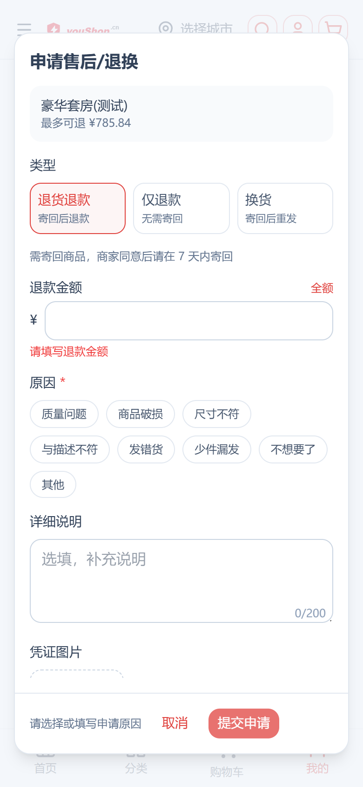
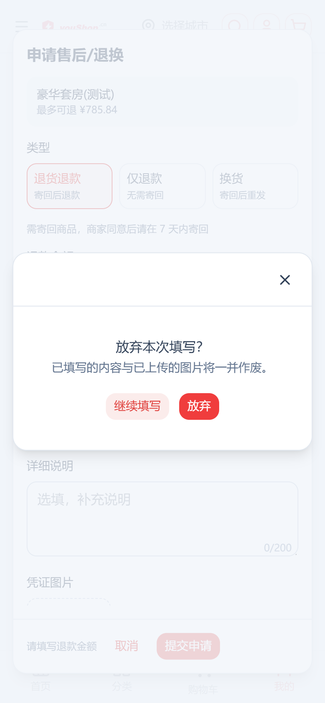
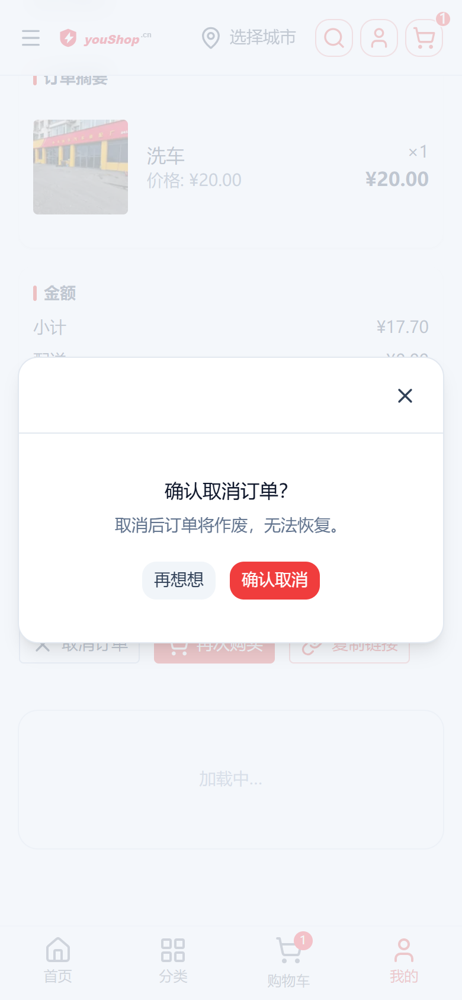
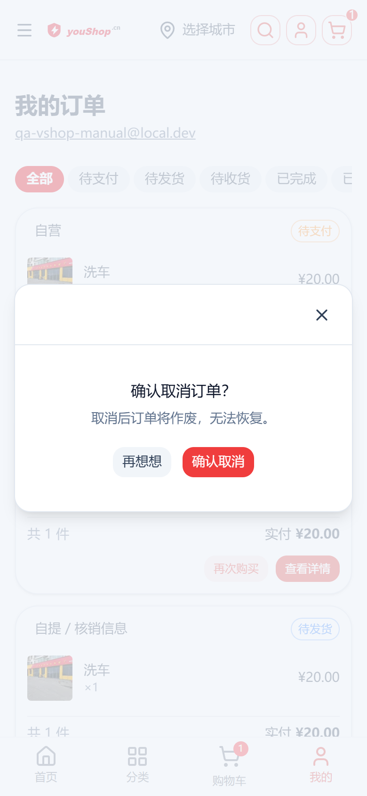

# 线上订单详情页弹层交互检查（2026-10-12）

> 站点：https://www.youshop.cn（nshop C 端）
> 页面：`/account/orders/<code>`（订单详情）
> 截图口径：手机视口 390×844、dpr=2（780×1688）、locale=zh-CN
> 探针：`scripts/_shot_order_modals.py`（本地探针，gitignore，不提交）
> 账号：`qa-vshop-manual@local.dev` / `Qa123456`；admin：`superadmin` @ `https://e.joho.cn/admin-api`

---

## 1. 弹层清单（源码勘探结论）

| # | 弹层 | 组件 | 触发条件 | 关闭方式 |
|---|---|---|---|---|
| 1 | 申请售后 | `AfterSalesCreateModal` | 订单行「申请售后」按钮（订单状态 ∈ Shipped/Delivered/PartiallyDelivered/Cancelled） | footer 取消（有草稿 → 二次确认）；提交成功跳转售后详情 |
| 2 | 放弃填写二次确认 | 同上（`discardConfirmOpen`） | 售后弹层有草稿时点「取消」 | 继续填写 / 放弃 |
| 3 | 首笔款支付弹窗 | `ScheduleDialog` | ScheduleBar 首笔款 payable「在线支付」；或进详情页自动弹一次（sessionStorage 按 orderId 防重） | 协议勾选 → 支付成功关闭；ESC/遮罩 |
| 4 | 酒店取消预订 | `OrderHotelCancelModal` | 酒店预订卡「取消预订」（booking confirmed/pendingDeposit）；打开即拉取消报价（free/partial/forfeit/unpaid/blocked） | 「再想想」/确认取消 |
| 5 | 酒店改期 | `OrderHotelRescheduleModal` | 酒店卡「改期」（confirmed + 改期名额未用 + 无在途补差）；选日期 → 查报价 → 确认 | 「再想想」/确认改期 |
| 6 | 取消订单 | 无弹窗 | `OrderActions`「取消订单」按钮（AddingItems/ArrangingPayment）→ **直接调 `cancelMyOrder` mutation，无二次确认** | toast 结果反馈 |

非弹层交互：核销码卡（只展示）、支付计划条非首笔款期次（直接支付）、在途补差「放弃补差」（armed 态轻量二次确认，非弹层）。

## 2. 线上事故：订单详情全部 404（已修复）

**现象**：探针首轮，qa 账号 6 笔订单详情**硬加载与客户端导航一律**渲染「404 未找到订单」。

**定位**（浏览器会话内直接发原始 GraphQL）：

```
Cannot return null for non-nullable field ShippingLine.shippingMethod.
```

**根因**：`OrderDetail` fragment 查询 `shippingLines { shippingMethod { name } }`，而 `ShippingLine.shippingMethod` 在 Vendure schema 为**非空**字段。线上存在历史订单的 shippingLine 指向了**已被后台删除的配送方式**（悬空外键），resolver 返回 null → 整个 `GetOrderByCode` 查询执行期报错 → 前端拿到 null → 404。列表查询（`OrderBase` fragment）不含 shippingLines，故列表正常、详情全挂。

**修复**（前端侧，任何悬空数据都不再影响详情页）：

- [fragments/order.gql](../../..//layers/base/gql/fragments/order.gql)：移除 `shippingLines` 子查询（留注释说明原因）
- [DeliveryInfo.vue](../../../layers/base/app/components/order/DeliveryInfo.vue)：配送方式展示加 `|| t("messages.general.na")` 兜底（OrderMetaCard 原有兜底）

**验证**：部署后 6/6 笔订单详情均正常渲染，深链/硬刷新/客户端导航全通。

**遗留提示（数据侧，未处理）**：后台删除配送方式会使历史订单运费明细丢失（前端显示「—」）。建议后台规范：配送方式停用而非删除；必要时可做数据修复把悬空 shipping_line 指回现存方式。

## 3. 探针验证结果（线上实拍）

运行：

```powershell
python scripts\_shot_order_modals.py
# 可选：$env:SHOT_OUT 指定输出目录
```

探针自动：登录 → 抓订单列表 → 逐单硬加载详情（检测自动弹窗/各按钮）→ 命中即逐弹层验证（**所有写 mutation 一律不触发**）。

| 检查项 | 结果 | 说明 |
|---|---|---|
| 详情页加载（6 笔订单） | PASS | 修复后无 404 |
| 售后弹层打开 | PASS | 标题「申请售后/退换」  |
| 提交按钮初始禁用 | PASS | 未选原因时 `canSubmit=false` |
| 选择原因 chip | PASS | 「质量问题」选中态 |
| 草稿取消 → 二次确认 | PASS | 「放弃本次填写？」  |
| 「继续填写」回表单 | PASS | 草稿保留 |
| 「放弃」关闭全部弹层 | PASS | 两层弹窗全关 |
| ScheduleDialog 首笔款弹窗 | SKIP | 线上 `paymentSchedules` 为 0 条，无数据（10-09 上线时已验收） |
| 酒店取消 / 改期弹层 | SKIP | 线上 `hotelBookings` 为 0 条，无数据（P4 Task 16 交付时已验收） |
| 取消订单（无确认） | **已改进** | 当日即补二次确认弹窗，见 §4 |

## 4. 取消订单二次确认弹窗（2026-10-12 当日补齐）

首轮检查发现「取消订单」点击直接调 `cancelMyOrder`（误触即真实取消），当日按售后「放弃填写」的模式补齐二次确认：

- 新组件 [OrderCancelConfirm.vue](../../../layers/base/app/components/order/OrderCancelConfirm.vue)（UModal + #body，两处共用；确认按钮 loading 由父侧 `confirmLoading` 传入）
- 接入 [OrderActions.vue](../../../layers/base/app/components/order/OrderActions.vue)（详情页）与 [OrderCardActions.vue](../../../layers/base/app/components/order/OrderCardActions.vue)（列表卡片）：点「取消订单」→ 弹窗 → 「再想想」关闭 /「确认取消」执行
- i18n 新增 `order.cancelConfirmTitle / cancelConfirmDesc / cancelConfirmBtn / cancelKeep`，12 个语言包同步（zh/ja/ko 本地化译文，其余按该包既有英文兜底风格）

线上验证（探针 `_shot_cancel_confirm.py`，两入口 × 三分支，7/7 PASS）：

| 检查项 | 详情页 | 列表卡片 |
|---|---|---|
| 弹窗打开（「确认取消订单？」） | PASS  | PASS  |
| 「再想想」关闭 | PASS | PASS |
| 「确认取消」执行（toast「订单已取消」） | PASS | PASS |
| 确认后操作区刷新（按钮消失） | PASS | — |

**测试数据口径**：线上所有支付方式 checkout 均一步到 `PaymentAuthorized`，状态机禁止回退，`ArrangingPayment` 挂起态造不出来；`canCancel` 覆盖 `AddingItems | ArrangingPayment`，故用**购物车单（AddingItems）**验证可取消路径（验后即取消，不留垃圾数据）。

**顺带发现（未改，待定夺）**：由于线上 checkout 从不停在 `ArrangingPayment`，该按钮实际只在购物车单（AddingItems）上出现；「已下单未支付」的单（PaymentAuthorized）前端不可取消（提示走客服）。若业务需要用户自助取消已下单未支付单，需扩 `canCancel` 状态集 + 后端配套退款逻辑，单独立项评估。

## 5. 关联

- 订单三版式/深链回归手册：[orders-multi-layout/README.md](../orders-multi-layout/README.md)
- 售后页手册：[aftersales-page-optimization](../aftersales-page-optimization/index.html)
- vendure 侧同日修复：cjk-plugin 注册 PaymentProfileMethod 实体 + 幂等建表（checkoutSplitted 对关联支付档案的商品下单报 No metadata，commit fe148303f）
